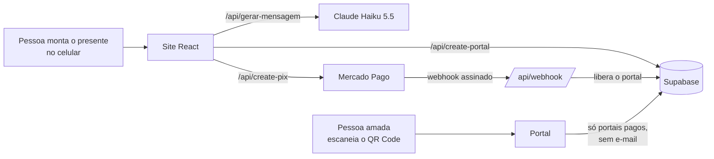

# Eternity

**Um presente digital que a pessoa monta em minutos e entrega com um QR Code:** uma página com as fotos do casal, a contagem do tempo juntos, música e uma declaração, escrita com a ajuda de um assistente de IA.

🔗 **No ar:** [eternity.dev.br](https://eternity.dev.br) · 🎥 **Vídeo (2 min):** [assistir no YouTube](https://youtu.be/Ibo9pED8x9Q)

> Produto real, em produção, com pagamento por Pix e clientes pagantes. Este repositório conta como ele foi diagnosticado, protegido e ganhou um assistente de IA.

---

## O problema

Criei o Eternity no começo de 2026 e consegui a primeira venda de forma orgânica, com um vídeo no TikTok. Ao retomar o projeto, fiz um diagnóstico completo do produto e do banco ([`docs/diagnostico.md`](docs/diagnostico.md)). Ele mostrou duas coisas:

1. **As pessoas travam na hora de escrever a declaração**, que é o coração do presente. Dos 15 portais criados e não pagos, **4 não tinham mensagem nenhuma** e **só 6 tinham 100 caracteres ou mais**.
2. **O produto tinha falhas graves de segurança:** qualquer visitante conseguia ler os e-mails, mensagens e fotos de todos os casais, e o preço era enviado pelo navegador (dava para pagar R$ 0,01).

Havia ainda uma "IA poética" que era falsa: esperava 2 segundos e trocava o texto da pessoa por uma de 3 frases fixas.

## A solução de IA: assistente de declaração

A pessoa conta, com as próprias palavras, como o casal se conheceu, uma memória marcante e o que mais admira, e escolhe o tom (fofo, engraçado ou emocionante). O assistente devolve uma declaração em português **usando esses detalhes reais**. A pessoa revisa, edita ou pede outra versão. Nada entra no portal sem a confirmação dela.

### Por que IA aqui, e não modelos prontos

- **Uma declaração só emociona com os detalhes do casal.** Um modelo genérico é exatamente o que ninguém quer dar de presente.
- **É uma tarefa que um modelo de linguagem faz bem:** transformar fatos soltos num texto coeso, no tom escolhido. Uma chamada à API, sem agente e sem ferramentas.
- **A pessoa continua no controle.** A IA sugere; quem decide é a pessoa.
- **Os modelos prontos continuam existindo como plano B,** se a API falhar.

Também decidi **onde não usar IA**: música, fotos e emojis não tinham dor real para resolver, e a IA ainda inventaria links de música que não existem.

### Como foi construído

| | |
|---|---|
| **Modelo** | Claude Haiku 5.5: texto curto, ~2 s por geração, custo baixo. Um modelo maior custaria 20 a 40 vezes mais sem ganho medido para esta tarefa. |
| **Prompt** | Versionado em arquivo ([`api/prompts/declaracao.md`](api/prompts/declaracao.md)) e avaliado por um script com **10 casos** (pouca informação, muita informação, tons, prompt injection, conteúdo ofensivo, brincadeira leve, nomes neutros). **6 versões** até passar 10 de 10. Registro completo em [`docs/ia/testes-prompt.md`](docs/ia/testes-prompt.md). |
| **Custo** | **US$ 0,000215 por geração** (média medida, com cache do prompt). Cerca de **R$ 0,004 por pessoa** que usa o assistente, 0,03% de uma venda. Contas em [`docs/ia/limites-e-custo.md`](docs/ia/limites-e-custo.md). |
| **Limites** | Tamanho por campo, 10 gerações por hora e 30 por dia por IP, teto de 500 por dia no site, timeout e limite de gasto no Console. A contagem fica no banco, porque em serverless não há memória compartilhada. |
| **Segurança da IA** | Dados do usuário separados das instruções, saída em JSON com esquema fixo, recusa de conteúdo ofensivo e nenhum texto do casal nos logs. |
| **Privacidade** | Só o que a pessoa digita no assistente vai para a API. O limite de uso guarda apenas um hash do IP, apagado em 2 dias (LGPD, minimização). |

### O que os testes me ensinaram

- **Desligar o "pensamento" do modelo funcionou melhor:** menos falhas (4 contra 8), ~30% menos tokens e respostas mais rápidas.
- **Exemplos no prompt eram copiados ao pé da letra.** Troquei por regras.
- **Gênero:** o modelo deduzia o gênero de quem escreve pelo nome ("obrigada"). Prompt sozinho não resolveu; uma checagem no código pede uma reescrita automática quando isso acontece. Testei também resolver a causa com um campo "quem está escrevendo", mas ele quebrou um caso que já funcionava, então **reverti e documentei** como próximo passo.
- **Limitação conhecida:** em ~2 de cada 9 textos ainda aparece um pequeno floreio inventado. Por isso o texto é sempre uma sugestão revisada pela pessoa.

Decisões completas, riscos e o que ficou de fora: [`docs/ia/decisoes.md`](docs/ia/decisoes.md).

---

## Como funciona



1. A pessoa monta o portal: link, data, fotos, mensagem (com o assistente) e plano.
2. O servidor cria o portal como **pendente** e gera um Pix com o preço calculado **no servidor**.
3. O Mercado Pago avisa o webhook. Ele valida a assinatura, confere o valor pago e libera o portal.
4. A pessoa recebe o link e o QR Code para entregar o presente.

## Decisões técnicas

**Banco.** Supabase (Postgres) com uma tabela de portais e uma de controle de uso da IA. O navegador **não acessa as tabelas**: a leitura pública passa por funções que devolvem só o necessário (portal pago, sem e-mail), e toda escrita passa pelo servidor.

**Autenticação.** Não há login, por decisão: é uma compra por impulso, e cadastro derruba a conversão. O controle de acesso é feito no servidor: um token de rascunho permite retomar o próprio portal, e só portais pagos ficam públicos. O próximo passo seria um link mágico por e-mail para o dono editar o portal.

**Integrações.** Mercado Pago (Pix e webhook com assinatura `x-signature`), Supabase e API da Anthropic, todas chamadas apenas pelo servidor, com segredos em variáveis de ambiente.

**Erros.** O webhook responde 5xx em falha de banco para o Mercado Pago reenviar (antes ele falhava em silêncio). O assistente cai para modelos prontos se a API falhar. No site, os erros aparecem na tela, sem pop-ups.

**Estrutura.** React + Vite no front e funções serverless na Vercel. É simples, barato e sem servidor para manter, o que combina com um micro-SaaS de uma pessoa.

## Segurança: o que foi encontrado e corrigido

O diagnóstico foi feito com um agente de IA (Claude Code) auditando o próprio produto, e cada correção foi testada e documentada antes de ir para produção.

| Problema | Correção |
|---|---|
| Qualquer visitante lia e-mails, mensagens e fotos de todos os casais | Tabelas fechadas (RLS); leitura só por funções que retornam o mínimo |
| Preço enviado pelo navegador | Preço calculado no servidor; webhook confere o valor pago |
| Chave secreta do banco escrita no código | Chave trocada, chaves antigas desativadas, segredos só em variáveis de ambiente |
| Webhook sem verificação | Assinatura validada; pagamento registrado com `payment_id` |
| API aberta para qualquer site | CORS restrito ao domínio |
| Link privado de cada portal enviado aos pixels de anúncio | Pixels removidos das páginas de portal |
| Banco pausando por inatividade | Tarefa diária agendada |

Publicação feita em etapas, com rollback pronto para cada uma ([`docs/fase-0-publicacao.md`](docs/fase-0-publicacao.md)). O fluxo completo foi comprovado com um Pix real.

---

## Próximos passos

- **Tons novos no assistente** (reflexivo, metafórico), que senti falta testando como usuário. Entram com uma rodada completa de testes.
- **Campo "quem está escrevendo"**, repetindo o teste com 3 rodadas antes de decidir.
- **Medir o efeito do assistente:** % de portais com mensagem de 100+ caracteres e conversão de quem usou o assistente comparada com quem não usou.
- E-mail de confirmação com o link do portal, nova identidade visual e edição do portal pelo dono.

## Rodando localmente

```bash
npm install
cp .env.example .env   # preencha com as suas chaves (cada variável está explicada no arquivo)
npm run dev            # front
vercel dev             # front + rotas /api (requer a Vercel CLI: npm i -g vercel)
npm run ia:avaliar     # roda os 10 casos de teste do prompt
```

**Stack:** React 18, Vite, Tailwind, Supabase, Mercado Pago, Anthropic API (Claude Haiku 5.5), Vercel.

---

Feito por Guilherme. Construído com o Claude Code como par de programação: as decisões de produto, o que priorizar e o que ficou de fora foram minhas; o agente implementou, testou e documentou comigo.
